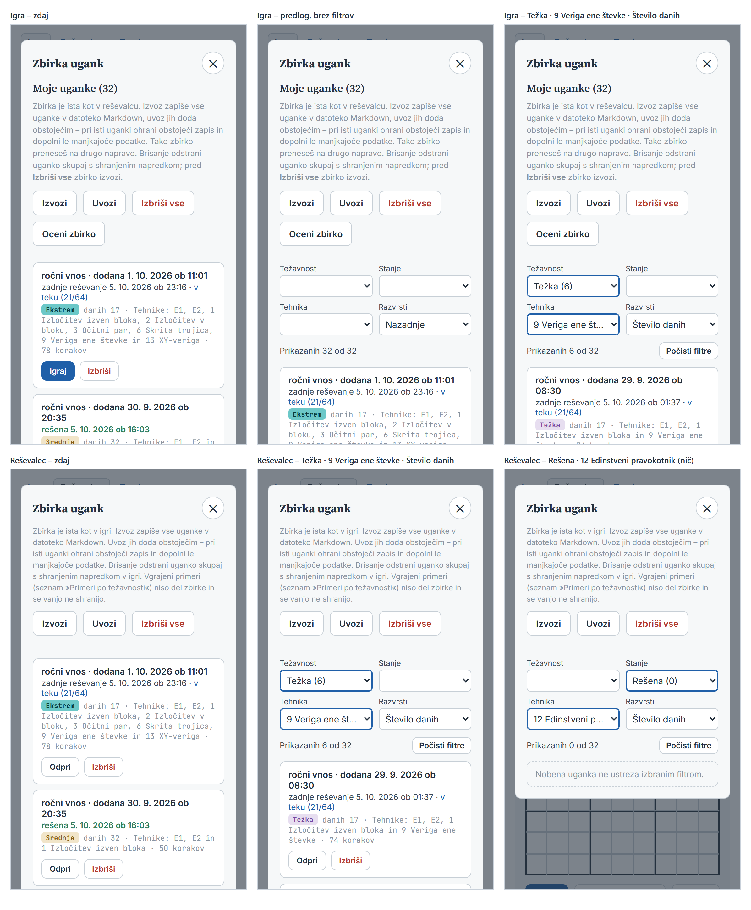
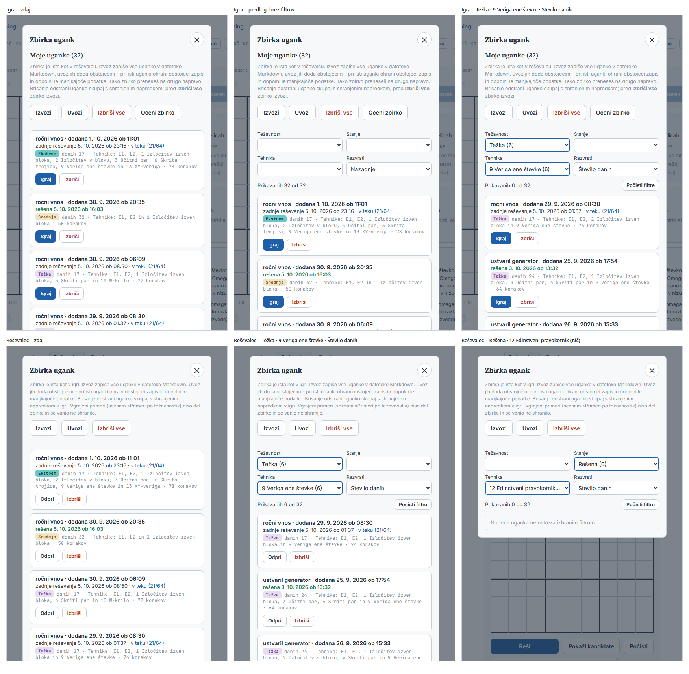

# Filtri in razvrščanje v zbirki (naloga 10) – načrt

Načrt 2026-10-12 (vir: `docs/uskladitev.md`, »Vrstni red po fazi 6«, vrstica 10, in »Odločitve 2026-10-12«, c).
**Stanje: potrjen 2026-10-12 – O1–O12 po priporočilu (O11 = B, ostale A), dodatek D1 (krajši namig v oknu, razdelek
4.1). Korak 1 – logika – narejen 2026-10-12.**

Izhodišče: commit `a98150a` (zapis odločitev 2026-10-12 v `docs/uskladitev.md`).

**Cilj.** V oknu »Zbirka ugank« (razdelek »Moje uganke« v igri, seznam v reševalcu) trije filtri – Težavnost, Stanje,
Tehnika – in razvrščanje, da v daljši zbirki hitro najdeš uganko, ki jo iščeš. Vgrajeni primeri ostanejo nespremenjeni.

Številke so **izmerjene** v brskalniku brez glave (`tools/brskalnik.js`): 320 × 640 in 375 × 667 px s posnemanjem
telefona ter 1280 × 800 px. Prototip je kopija aplikacij v začasni mapi s spremembami po predlogu (ni v repozitoriju).
Testna zbirka prototipa ima 32 ugank – 24 iz generatorja (`ustvariUganko()`, vsaka preverjena s `countSolutions()`) in
8 iz `docs/uganke.md` –, zapisi so iz `zbirkaShraniResitev()`; v teku je vsaka tretja, rešena vsaka peta (podatki v
zapisu, brez shranjene igre). Za meritve časa še 192 ugank (vsaka od 32 s petimi zamenjavami števk – zamenjava
ohrani enolično rešitev, preverjeno s `countSolutions()`). Iz prototipa so meritve »predlog« in sliki v
`docs/slike/naloga10/`.

## 0. Povzetek

- **Mesto:** pod vrstico gumbov (Izvozi … Oceni zbirko) in vrstico sporočil, nad karticami. Štiri okenca v mreži dva
  po dva – **Težavnost · Stanje / Tehnika · Razvrsti** –, ime nad okencem; pod njimi vrstica **»Prikazanih 6 od 32«**
  in desno **»Počisti filtre«** (samo pri vklopljenem filtru). Okno ostane 480 px; mreža je enaka na telefonu in
  monitorju (okence 148 px pri 375 px, 216 px pri 1280 px).
- **Filtri:** prva možnost je prazna (filter izklopljen), ob vsaki vrednosti število ugank, npr. »Težka (6)«,
  »9 Veriga ene števke (6)«. Ponujene so samo vrednosti, ki so v zbirki. Sprememba takoj osveži seznam, filtri se
  seštevajo (IN). Vklopljeno okence ima modro obrobo.
- **Razvrsti:** Nazadnje (privzeto, kot zdaj) · Težavnost · Število danih · Datum dodajanja; ob enakem ključu velja
  »Nazadnje«.
- **Pomnjenje:** nov ključ `sudoku.zbirka.filtri`, skupen igri in reševalcu; ob odprtju okna se izbira uporabi,
  vrednost, ki je v zbirki ni več, se izprazni.
- **Prazen izid:** namesto kartic »Nobena uganka ne ustreza izbranim filtrom.«
- **Koraki:** 1 – logika brez DOM-a v `shared/zbirka.js` s testi (brez vidne spremembe); 2 – okenca v igri
  (`shared/zbirka-ui.js`, `shared/zbirka.css`, `igra/`) in Pomoč igre; 3 – reševalec, Pomoč reševalca in zaključek.
- **Odločitve:** O1–O12 (razdelek 4).

## 1. Kako je zdaj

### 1.1 Okno »Zbirka ugank«

| | Igra (`igra/index.html`, `#zbirkaDialog`) | Reševalec (`app/index.html`, `#library`) |
|---|---|---|
| 1 | glava »Zbirka ugank« in ✕ | glava »Zbirka ugank« in ✕ |
| 2 | naslov »Moje uganke (32)« (`#mojeNaslov`) | – |
| 3 | namig (6 vrstic pri 375 px) | namig (7 vrstic pri 375 px) |
| 4 | gumbi Izvozi, Uvozi, Izbriši vse, Oceni zbirko, Prekini (`.dialog-gumbi.zbirka-gumbi`) | gumbi Izvozi, Uvozi, Izbriši vse (`.lib-tools`) |
| 5 | sporočila (`#zbirkaStatus`, vsaj 18 px) | sporočila (`#libStatus`, vsaj 18 px) |
| 6 | »Zapiši ocene (N)« / »Prekliči« (`#ocenaGumbi`, samo pri predlogu ocene) | – |
| 7 | kartice (`#zbirkaSeznam`) | kartice (`#libList`) |
| 8 | zložen razdelek »Vgrajeni primeri« | – |

Seznam je v obeh aplikacijah isti (`zbirkaBeri()`), kartica tudi (`zbirkaKartica()` → `zbirkaIzrisiKartico()`),
različni so samo gumbi (igra »Igraj / Nadaljuj / Poglej« in »Izbriši«, reševalec »Odpri« in »Izbriši«).

### 1.2 Funkcije

- `shared/zbirka.js` (brez DOM-a): `zbirkaBeri()`; `zbirkaZaSeznam(zbirka)` – vrstni red »po mojem zadnjem dogodku«
  (`igrano || dodano`, najnovejše na vrhu; nato `dodano`, nato mesto v shrambi); `zbirkaStanjeUganke(danosti, z,
  povzetek)` → `kljuc` `nova` / `v-teku` / `resena` (vir je začeta shranjena igra, sicer zapis); `zbirkaPovzetekZapisa()`
  – odigra poteze shranjene igre, pri polni mreži pokliče `solutionOf()`; `zbirkaTehnikeZapisa(z)` – tehnike na kartici
  (pri težki uganki pot ocene `potOcene`/`zbirkaPotTezke()` z eno napredno tehniko, sicer dnevnik `solve()`; poskus je
  »ugibanje«); `zbirkaKratkoImeTehnike()` – »7 X-krilo«, »E1«; `TEZAVNOSTI` (8 vrednosti v vrstnem redu stopenj).
- `shared/zbirka-ui.js`: `zbirkaIzrisiKartico()`, `zbirkaPoveziIzvozUvoz()` (`poUvozu()` aplikacije),
  `zbirkaObSpremembiDrugje()` (dogodek `storage` za `sudoku.zbirka.v1` in `sudoku.igra.v1`).
- Igra (`igra/igra.js`): `izrisiZbirko()` (uskladi igranje, izriše primere in kartice), `karticaUganke()` (izračuna
  povzetek in kartico, doda vrstico ocene `izrisiOceno()`), gumb »Zbirka« (sporočilo, `ocenaPocisti()`, izris, primeri
  odprti/zaprti), `izbrisiUganko()`, »Izbriši vse«, uvoz, »Oceni zbirko« (predlogi v `ocene` se izrišejo pri karticah,
  »Zapiši ocene« zapiše vse predloge in znova izriše seznam), sprememba v drugem zavihku.
- Reševalec (`app/zbirka.js`): `zbirkaIzrisiSeznam()`, `zbirkaOdpri()`, »Izbriši«, »Izbriši vse«, uvoz, sprememba v
  drugem zavihku.

### 1.3 Polja zapisa in shramba

Zapis (`ZBIRKA_POLJA` in `potOcene`): `danosti`, `tezavnost`, `izvor`, `dodano`, `igrano`, `izpolnjeno`, `napaka`,
`nazadnje`, `reseno`, `koraki`, `ugibanje`, `tehnike`, `opomba`, `potOcene`. Za filtre in razvrščanje so pomembni:

| Podatek | Iz česa |
|---|---|
| težavnost | `tezavnost` (ena od `TEZAVNOSTI` ali prazno – razdelek 3.1) |
| stanje | `zbirkaStanjeUganke()` – shranjena igra v `sudoku.igra.v1` (poteze, kazalec) ali `igrano`/`izpolnjeno`/`napaka` |
| tehnike | `zbirkaTehnikeZapisa()` – `potOcene` pri težki, sicer `tehnike` (`[[ključ, število], …]`) |
| število danih | `danosti` (81 − prazne) |
| datum dodajanja | `dodano` (»2026-09-21 16:33« – na minuto natančno; ob uvozu brez datuma čas uvoza, enak za vse uvožene) |
| nazadnje | `igrano \|\| dodano` (`zbirkaZaSeznam()`) |

Ključi shrambe zdaj: `sudoku.zbirka.v1`, `sudoku.igra.v1`, `sudoku.igra.seznami`, `sudoku.igra.kandidati`,
`sudoku.igra.poud`, `sudoku.igra.stopnja`, `sudoku.trening.seznami`, `sudoku.trening.zadnja`. Filtrov ne shranjuje nič.

### 1.4 Mere zdaj

| | 320 px | 375 px | 1280 px |
|---|---|---|---|
| plošča okna / vsebina | 288 / 250 px | 343 / 305 px | 480 / 442 px |
| igra: vrh prve kartice (okno visoko 640 / 667 / 800 px) | 397 px | 378 px | 292 px |
| igra: cele kartice v oknu | 1 | 1 | 3 |
| reševalec: vrh prve kartice | 335 px | 300 px | 264 px |
| reševalec: cele kartice v oknu | 1 | 2 | 3 |

## 2. Predlog

### 2.1 Postavitev

- **Mesto (O1 A):** nov vsebnik tik nad seznamom kartic – v igri za vrstico »Zapiši ocene« (`#ocenaGumbi`), v
  reševalcu za sporočili (`#libStatus`). Sporočila ostanejo ob gumbih, na katere se nanašajo.
- **Mreža dva po dva** (CSS `grid-template-columns: 1fr 1fr`, razmik 8 px navpično, 10 px vodoravno): Težavnost ·
  Stanje / Tehnika · Razvrsti. Ime okenca je nad njim (12 px, `--ink2`, kontrast 8,77 : 1 na podlagi okna), okence
  čez vso širino stolpca. Vsako okence je v svojem `<label>` (bralnik zaslona prebere ime).
- **Okence:** videz kot okence »Pokaži« nad koraki v reševalcu (naloga 6b): pisava Inter 14 px, obroba `--line`,
  zaobljenost 6 px, bela podlaga; odmik besedila 6 px (namesto 8 px – da »Datum dodajanja« pri 375 px gre v okence) in
  predolg napis z »…« (O10). Vklopljen filter ima modro obrobo 2 px (`--blue`, kontrast 6,44 : 1 na beli; O12).
- **Vrstica pod mrežo** (32 px): levo »Prikazanih 6 od 32« s sklanjanjem (`sklanjaj()`: »Prikazana 1 od 32«,
  »Prikazani 2 od 32«, »Prikazane 3 od 32«, »Prikazanih 5 od 32«), desno »Počisti filtre« – samo, ko je vklopljen vsaj
  en filter. »Počisti filtre« izklopi vse tri filtre, »Razvrsti« ostane (ni filter).
- **Prazen izid:** namesto kartic ena kartica z razredom `prazno` (črtkana, kot »Zbirka je prazna …«): »Nobena uganka
  ne ustreza izbranim filtrom.«
- **Prazna zbirka:** okenc in vrstice ni, ostane obstoječe besedilo »Zbirka je prazna …«.
- Naslov »Moje uganke (32)« v igri in število na gumbu »Zbirka« ostaneta število vseh ugank.

### 2.2 Okenca in možnosti

| Okence | Možnosti (za prazno prvo) | Vrednost v zapisu |
|---|---|---|
| Težavnost | vrednosti iz `TEZAVNOSTI` v njihovem vrstnem redu (Lahka … Presega tehnike, Več rešitev, Brez rešitve), nato »Ni določena« (O6) – samo tiste, ki so v zbirki | `tezavnost` |
| Stanje | »Nova«, »V teku«, »Rešena« – samo tista, ki so v zbirki; rešena uganka, ki jo rešuješ znova, je »V teku« (O3) | ključ `zbirkaStanjeUganke()` |
| Tehnika | »1 Izločitev izven bloka« … »13 XY-veriga« (`zbirkaKratkoImeTehnike()`), po številkah – samo tehnike, ki so na kartici vsaj ene uganke (O4); brez E1, E2 in ugibanja (O5) | ključ iz `ALL_TECHNIQUES` |
| Razvrsti | Nazadnje · Težavnost · Število danih · Datum dodajanja (vedno ima vrednost) | – |

- **Število v oklepaju (O2 A):** koliko ugank bi bilo prikazanih, če izbereš to možnost – ob upoštevanju drugih dveh
  filtrov. Izbrana možnost ima zato isto število kot vrstica »Prikazanih N«. Možnost z »(0)« ostane izbirna (izbira
  pokaže sporočilo o praznem izidu).
- Prva črka možnosti je velika, kot pri »Težka« in »Nazadnje« (kartica ima stanje z malo – »v teku«).
- Števila se osvežijo ob vsaki spremembi: po izbiri »Težka (9)« in nato tehnike 9 je v okencu Težavnost »Težka (6)«
  (prototip, slika).
- Izmerjene dolžine napisov v zaprtem okencu (testna zbirka): pri 375 px (okence 148 px) se odrežejo »Presega tehnike
  (1)« (potrebuje 160 px) in 6 od 11 tehnik (»1 Izločitev izven bloka (26)« 209 px, »2 Izločitev v bloku« 185 px,
  »5 Očitna trojica« 157 px, »6 Skrita trojica« 153 px, »9 Veriga ene števke« 191 px, »12 Edinstveni pravokotnik«
  222 px); pri 320 px (120 px) še »Zelo težka«, vse tehnike in »Datum dodajanja«; pri 1280 px (216 px) samo
  »12 Edinstveni pravokotnik (1)«. Seznam možnosti, ki se odpre ob dotiku ali kliku, ima cela imena.

### 2.3 Razvrsti

| Možnost | Ključ | Ob enakem ključu |
|---|---|---|
| Nazadnje (privzeto) | `zbirkaZaSeznam()` – kot zdaj | – |
| Težavnost | vrstni red `TEZAVNOSTI` (Lahka … Presega tehnike, Več rešitev, Brez rešitve), na koncu »ni določena« | Nazadnje |
| Število danih | od najmanj | Nazadnje |
| Datum dodajanja | `dodano`, najnovejše na vrhu; zapis brez datuma na koncu | Nazadnje |

Izvedba: najprej vrstni red »Nazadnje«, nato stabilno razvrščanje po izbranem ključu (stabilnost `Array.prototype.sort`
v brskalnikih in Node). Pri »Datum dodajanja« je enakih ključev malo, a so (minuta, uvoz brez datuma).

### 2.4 Pomnjenje

- Nov ključ **`sudoku.zbirka.filtri`** (JSON): `{ tezavnost, stanje, tehnika, razvrsti }` – `null` = filter izklopljen,
  `''` pri težavnosti = »ni določena«, stanje kot ključ (`nova` / `v-teku` / `resena`), tehnika kot ključ iz
  `ALL_TECHNIQUES` (npr. `Turbot Fish` – ime za prikaz se lahko spremeni, ključ ne), razvrsti `nazadnje` / `tezavnost` /
  `danih` / `dodano`. En ključ za igro in reševalec (isti izvor, kot zbirka). Vpiše se v seznam ključev v `CLAUDE.md`.
- **Zapis** ob vsaki spremembi okenca in ob »Počisti filtre«. **Branje** ob odprtju okna (gumb »Zbirka«). Sprememba v
  drugem zavihku ne spremeni odprtega okna – velja ob naslednjem odprtju.
- **Ob odprtju** se vrednost, ki je ni pri nobeni uganki v zbirki (npr. zadnja uganka s tehniko 12 je izbrisana), izprazni
  in izprazni tudi v shrambi; neznan `razvrsti` postane `nazadnje`; pokvarjen zapis ali nedosegljiva shramba – vse
  izklopljeno, brez napake. Kar se zgodi med odprtim oknom, določa O7.
- Prototip: po ponovnem odprtju strani so bile izbire (»Rešena (0)«, »12 Edinstveni pravokotnik (0)«, »Število danih«)
  obnovljene v igri in reševalcu.

### 2.5 Pomoč (osnutek besedil; končno besedilo preverijo `besedila-html`, `locila`, `izrazi`)

- **Igra**, razdelek »Zbirka ugank«, nov podnaslov »Filtri in razvrščanje« za »Uganka v seznamu«: »Nad seznamom
  **Moje uganke** so okenca **Težavnost**, **Stanje**, **Tehnika** in **Razvrsti**. Prazno okence pomeni, da filter ni
  vklopljen; ob vsaki možnosti je število ugank, ki jih dobiš, če jo izbereš. Filtri se seštevajo – ostanejo uganke, ki
  ustrezajo vsem izbranim. **Tehnika** ponudi samo tehnike, ki so v tvoji zbirki, brez E1 in E2 (ima ju vsaka uganka).
  **Razvrsti** uredi seznam: **Nazadnje** (zadnja reševana ali dodana na vrhu), **Težavnost** (od lahke), **Število
  danih** (od najmanj) ali **Datum dodajanja** (najnovejša na vrhu). Vrstica nad seznamom pove, koliko ugank je
  prikazanih, **Počisti filtre** izklopi vse tri filtre. Izbiro si brskalnik zapomni – v igri in reševalcu enako.«
- **Reševalec**, razdelek »Zbirka ugank«, nov odstavek za obstoječim: »V oknu **Zbirka ugank** seznam zožiš z okenci
  **Težavnost**, **Stanje** in **Tehnika** in ga urediš z **Razvrsti** – enako kot v igri. Prazno okence pomeni, da
  filter ni vklopljen, filtri se seštevajo, **Počisti filtre** jih izklopi. Izbiro si brskalnik zapomni.«

### 2.6 Koda

- **`shared/zbirka.js`** (brez DOM-a, testi v Node): `ZBIRKA_FILTRI_KLJUC`, `ZBIRKA_STANJA`, `ZBIRKA_RAZVRSTI`;
  `zbirkaLastnostiUganke(z, igra)` → `{ z, povzetek, tezavnost, stanje, tehnike, danih }` (povzetek gre naprej v
  `zbirkaKartica()` – izračuna se enkrat, O11); `zbirkaTehnikeFiltra(z)` – ključi tehnik z istega vira kot
  `zbirkaTehnikeZapisa()` (skupna pomožna funkcija, obnašanje kartice ostane); `zbirkaMoznostiFiltrov(lastnosti, izbira)`;
  `zbirkaFiltriraj(lastnosti, izbira)` (filtri in razvrščanje); `zbirkaFiltriBeri()`, `zbirkaFiltriPisi()`,
  `zbirkaFiltriVeljavni(izbira, lastnosti)` (izpraznitev ob odprtju); `zbirkaNapisPrikazanih(n, m)`; pri O11 B še
  `zbirkaResitev(danosti)` – rešitev uganke, izračunana enkrat na stran (`zbirkaPovzetekIgre()` jo uporabi pri polni
  mreži).
- **`shared/zbirka-ui.js`:** `zbirkaUstvariFiltre(vsebnik, { obSpremembi })` → `{ odpri(), uporabi(zbirka, igre),
  pripis(besedilo) }` – izriše okenca in vrstico, ob spremembi zapiše izbiro in pokliče `obSpremembi()` (aplikacija
  znova izriše seznam); `uporabi()` vrne lastnosti ugank za izris v pravem vrstnem redu, osveži možnosti in vrstico ter
  skrije vsebnik pri prazni zbirki; `pripis()` za O8.
- **`shared/zbirka.css`:** `.zbirka-filtri`, `.zb-filtri-mreza`, `.zb-filter`, `.zb-prikazanih`, `select.vklopljen`.
- **Igra:** vsebnik `
` v `igra/index.html`; v `igra/igra.js` `izrisiZbirko()` uporabi
  `uporabi()` in sporočilo praznega izida, `karticaUganke()` sprejme povzetek, gumb »Zbirka« pokliče `odpri()`,
  pripis skritih predlogov ocene (O8); Pomoč.
- **Reševalec:** vsebnik `
` v `app/index.html`; `app/zbirka.js` enako v `zbirkaIzrisiSeznam()` in
  `zbirkaOdpri()`; Pomoč.
- Logika tehnik in motor se ne spremenita – banke vaj, primerov in posnetkov ni treba ustvariti znova.

### 2.7 Meritve predloga

| | 320 px | 375 px | 1280 px |
|---|---|---|---|
| okence (š × v) | 120 × 35 px | 148 × 35 px | 216 × 35 px |
| vsebnik filtrov (mreža 114 + razmik 8 + vrstica 32) | 154 px | 154 px | 154 px |
| igra: vrh prve kartice (zdaj → predlog) | 397 → 563 px | 378 → 544 px | 292 → 458 px |
| igra: cele kartice v oknu | 1 → 0 | 1 → 0 (vidna je zgornja tretjina prve) | 3 → 2 |
| reševalec: vrh prve kartice | 335 → 499 px | 300 → 464 px | 264 → 428 px |
| reševalec: cele kartice v oknu | 1 → 0 | 2 → 1 | 3 → 2 |
| preliv vodoravno | ne | ne | ne |

Čas (mediana sedmih izrisov v brskalniku; meritve nihajo, zato dva teka):

| | zdaj | prototip |
|---|---|---|
| izris okna igre, 32 ugank | 10,2 / 8,9 ms | 16,7 / 17,5 ms |
| izris okna reševalca, 32 ugank | 3,6 / 6,5 ms | 13,3 / 10,8 ms |
| igra, 192 ugank | 28,7 / 73,6 ms | 52,5 / 56,9 ms |
| reševalec, 192 ugank | 17,8 / 56,7 ms | 42,3 / 42,7 ms |

V Node: sama logika (lastnosti, možnosti s števili, filtriranje in razvrščanje) 0,6 ms pri 32 in 2,5 ms pri 192
ugankah – brez shranjenih iger. Prototip povzetek igre izračuna dvakrat (filter in kartica). **Povzetek shranjenih iger**
pri 192 ugankah: igre s polovico vpisov 1,6 ms, **vse igre polne (rešene) 279 ms** – pri polni mreži
`zbirkaPovzetekIgre()` pokliče `solutionOf()` (pribl. 1,5 ms na uganko). To plača že današnji izris, s filtri pa vsaka
sprememba okenca (O11).

### 2.8 Sliki

- `docs/slike/naloga10/filtri-375.png` – zgoraj igra: zdaj · predlog brez filtrov · Težka, 9 Veriga ene števke, Število
  danih; spodaj reševalec: zdaj · isti filtri · Rešena in 12 Edinstveni pravokotnik (prazen izid). Vidni del okna
  375 × 667 px (dvojna ločljivost).
- `docs/slike/naloga10/filtri-1280.png` – isto pri 1280 × 800 px (izrez 560 px okoli okna).

Seznama možnosti, ki se odpre ob dotiku, brskalnik brez glave ne posname (sistemski gradnik).

## 3. Ocene

### 3.1 Uganka brez ocene težavnosti

- **Ali obstaja:** redko, a da. Prazna `tezavnost` nastane (a) pri **uvozu** uganke, ki nima znane težavnosti in pri
  kateri `countSolutions()` v proračunu 50.000 poskusov ne preveri enoličnosti (`oceniTezavnost()` vrne `''`); (b) pri
  **starem zapisu** z neznanim imenom (npr. nekdanji »Drugo« – `zbirkaTezavnost()` ga ob branju spremeni v `''`).
  »Oceni zbirko« jo popravi samo, če enoličnost preveri. Ne nastane ob reševanju v reševalcu (shrani se samo uganka z
  natanko eno rešitvijo) in ne v igri (»Nova uganka« – ustvarjena ali vnesena uganka je preverjena). Kartica take
  uganke nima značke. Možni sta tudi »Več rešitev« in »Brez rešitve« (uvoz, »Oceni zbirko«) – to sta navadni vrednosti.
- **Pri filtru (O6 A):** možnost »Ni določena (N)« na koncu okenca Težavnost, samo kadar taka uganka obstaja.
- **Pri razvrščanju:** po težavnosti na koncu, za »Brez rešitve«.
- Podobno **uganka brez podatka o tehnikah** (uvoz brez vrstice »Tehnike«, kartica »Tehnike: ni podatkov«): pri nobeni
  tehniki se ne šteje, vidna je samo pri izklopljenem filtru Tehnika. »Oceni zbirko« podatek dopolni.

### 3.2 Osvežitev seznama pri vklopljenih filtrih

| Dogodek | Kaj se zgodi |
|---|---|
| »Izbriši« (igra, reševalec) | seznam se znova izriše z istimi filtri; števila in »od M« se zmanjšajo; če je bila to zadnja uganka z izbrano vrednostjo, vrednost ostane izbrana z »(0)« in prazen izid, dokler okna ne zapreš (O7 A); ob naslednjem odprtju se izprazni |
| »Izbriši vse« | zbirka je prazna – okenc ni, »Zbirka je prazna …«; izbira v shrambi se izprazni ob naslednjem odprtju |
| »Uvozi« | filtri ostanejo; nove vrednosti se pojavijo v okencih, števila in »od M« se povečajo; sporočilo uvoza ostane, vrstica »Prikazanih N od M« pokaže, da del zbirke skrivajo filtri |
| »Oceni zbirko« (med ocenjevanjem) | filtri delujejo; ob spremembi filtra se predlogi ocene izrišejo pri vidnih karticah (kot zdaj – `karticaUganke()` jih doda iz `ocene`); filtrira se po zapisani težavnosti in tehnikah, ne po predlogu; vrstica dobi pripis skritih predlogov (O8 A) |
| »Zapiši ocene« | seznam se izriše z istimi filtri – uganka s spremenjeno težavnostjo ali tehnikami lahko izgine iz seznama ali se pojavi; vrednost, ki je ni več, po O7 |
| »Prekliči« (ocene) | seznam se izriše z istimi filtri, pripis izgine |
| sprememba v drugem zavihku | kot zdaj seznam znova izriše (z istimi filtri v tem oknu) |
| »Igraj« / »Odpri« | okno se zapre; ob naslednjem odprtju se izbira znova prebere |

### 3.3 Trenutno odprta uganka, ki jo filter skrije

Uganka, ki je odprta v igri (kartica »Uganka«) ali v vnosni mreži reševalca, je v seznamu označena z modro črto in
značko »trenutno odprta«. **Predlog (O9 A):** filter jo skrije kot vsako drugo – okno je za izbiro druge uganke, odprta
uganka pa je na zaslonu že zunaj okna; vrstica »Prikazanih N od M« pove, da so nekatere skrite. Izjema (vedno prikazana
na vrhu) bi pomenila, da seznam ne ustreza filtrom, in bi zmedla števila.

## 4. Odločitve

| | Možnosti | Priporočilo |
|---|---|---|
| **O1** mesto | **A** tik nad karticami – v igri za vrstico sporočil in »Zapiši ocene«, v reševalcu za vrstico sporočil; **B** takoj pod vrstico gumbov, nad sporočili (sporočilo uvoza ali ocene bi bilo med okenci in karticami) | A |
| **O2** število v oklepaju | **A** ob upoštevanju drugih dveh filtrov (koliko jih dobiš, če izbereš; »(0)« ostane izbirna); **B** v vsej zbirki (število se ne spreminja, a kombinacija lahko da prazen izid brez opozorila) | A |
| **O3** rešena uganka, ki jo rešuješ znova (»rešena … · znova v teku«) | **A** »V teku« – kot napis stanja v barvi in gumb »Nadaljuj«; **B** »Rešena« – kot zapis v zbirki in izvoz; **C** pri obeh | A |
| **O4** tehnike uganke za filter | **A** kot na kartici (`zbirkaTehnikeZapisa()` – pri težki uganki pot ocene z eno napredno tehniko, sicer dnevnik `solve()`); **B** vse tehnike dnevnika `solve()` (pri težki lahko druga napredna, ki je kartica ne kaže) | A |
| **O5** ugibanje | **A** ni med tehnikami (uganke z ugibanjem so »Presega tehnike« – ugibanje ni tehnika, `docs/uskladitev.md` 7.3); **B** zadnja možnost »ugibanje (N)« | A |
| **O6** uganka brez težavnosti | **A** možnost »Ni določena (N)« na koncu, samo kadar obstaja; pri razvrščanju na koncu; **B** brez možnosti (vidna samo pri izklopljenem filtru) | A |
| **O7** izbrana vrednost, ki med odprtim oknom izgine (Izbriši, Zapiši ocene, drug zavihek) | **A** ostane izbrana z »(0)« do zaprtja okna, ob naslednjem odprtju se izprazni; **B** izprazni se takoj (seznam nenadoma pokaže vse) | A |
| **O8** »Oceni zbirko« pri vklopljenih filtrih | **A** filtri ostanejo, vrstica dobi pripis »· skritih predlogov ocene: 3« (»Zapiši ocene (N)« zapiše tudi skrite); **B** »Oceni zbirko« izklopi filtre; **C** nič posebnega | A |
| **O9** trenutno odprta uganka, ki jo filter skrije | **A** brez izjeme; **B** vedno prikazana na vrhu; **C** skrita, s pripisom v vrstici »Prikazanih« | A |
| **O10** predolg napis v zaprtem okencu | **A** 14 px, odmik 6 px, »…« (pri 375 px se odreže 6 od 11 tehnik testne zbirke in »Presega tehnike«, pri 1280 px samo »12 Edinstveni pravokotnik«); **B** 13 px (pri 375 px še vedno 5 tehnik); **C** Tehnika čez oba stolpca (mreža ni več dva po dva) | A |
| **O11** hitrost pri veliki zbirki | **A** povzetek igre enkrat na izris (filter in kartica); **B** kot A in rešitev uganke izračunana enkrat na stran (`zbirkaResitev()`) – pri 192 rešenih ugankah sprememba okenca brez pribl. 280 ms za `solutionOf()` | B |
| **O12** videz vklopljenega filtra | **A** modra obroba 2 px (`--blue`, 6,44 : 1), kot na slikah; **B** brez – vidi se samo izbrana vrednost | A |

**Potrjeno 2026-10-12:** O1–O12 po priporočilu – O11 = B, vse druge A.

### 4.1 Dodatek D1 – krajši namig v oknu »Zbirka ugank« (2026-10-12)

Uvodno besedilo nad gumbi se skrajša, da je na telefonu prva kartica spet vidna (razdelek 8).

- **Igra** (`igra/index.html`, `p.namig`), korak 2: »Zbirka je ista kot v reševalcu. Z **Izvozi** in **Uvozi** jo
  preneseš na drugo napravo; pred **Izbriši vse** jo izvozi. Več v Pomoči.«
- **Reševalec** (`app/index.html`, `p.cand-hint`), korak 3: »Zbirka je ista kot v igri. Z **Izvozi** in **Uvozi** jo
  preneseš na drugo napravo; pred **Izbriši vse** jo izvozi. Vgrajeni primeri niso del zbirke. Več v Pomoči.«
- Podrobnosti, ki odpadejo iz namiga (datoteka Markdown, pravilo za isto uganko pri uvozu, brisanje skupaj z
  napredkom v igri), so v Pomoči igre že; v Pomoč reševalca (razdelek »Zbirka ugank«) pridejo s kratkim odstavkom
  (korak 3).
- Scenarij izmeri vrh prve kartice pri 320, 375 in 1280 px (zdaj → s filtri in krajšim namigom); številke so v
  poročilu koraka 2 (igra) in 3 (reševalec).

## 5. Koraki

Vsak korak: najprej test, ki na stari kodi pade, nato sprememba; hitri testi sproti, vsi pred commitom; opisi v
`docs/opis/` (`stanje-zbirka.md`, `igra.md`, `resevalec.md`, `testi.md`, `orodja.md`); commit, push, nato se ustavim.

1. **Logika (brez vidne spremembe).** `shared/zbirka.js` po 2.6; nov hitri test `tests/zbirka-filtri.test.js` (Node,
   uganke iz `docs/uganke.md` in zamenjave števk, preverjene s `countSolutions()`; zapisi iz `zbirkaShraniResitev()`,
   stanja iz shranjenih iger): lastnosti (O3, O4, O5), možnosti v stalnem vrstnem redu in samo prisotne, števila po O2
   (izbrana = število prikazanih), IN, razvrščanje vseh štirih načinov z »Nazadnje« ob enakem ključu, prazna težavnost
   na koncu (O6), shramba (pokvarjen zapis, neznan `razvrsti`, izpraznitev odsotnih vrednosti), napis »Prikazanih« s
   sklanjanjem (1, 2, 3, 5, 101), `zbirkaResitev()` (O11). Ključ `sudoku.zbirka.filtri` v `CLAUDE.md`. Obstoječi testi
   kartice (`zbirka-zapis`) ostanejo zeleni.
2. **Igra.** `shared/zbirka-ui.js`, `shared/zbirka.css`, `igra/index.html` (z D1 – krajši namig), `igra/igra.js`,
   Pomoč igre. Test v
   nadomestnem DOM-u (`tests/igra-ui.test.js` ali nov `tests/zbirka-filtri-ui.test.js`): okenca in imena, možnosti s
   števili, sprememba → seznam, »Počisti filtre« (vidnost, »Razvrsti« ostane), prazen izid, prazna zbirka, pomnjenje
   (nov `makeDom(dom.shramba)`), izpraznitev ob odprtju, O7 po »Izbriši«, »Uvozi«, »Oceni zbirko« s pripisom in
   »Zapiši ocene«, trenutno odprta skrita. Nov scenarij `tools/preveri-naloga10-brskalnik.js --korak 2` (320, 375 z
   dotikom, 1280 z miško). Posnetek igre (`--primerjaj tools/posnetki/igra-po-xy-veriga.json` – zbirke ne odpira, mora
   biti enak).
3. **Reševalec in zaključek.** `app/index.html` (z D1 – krajši namig), `app/zbirka.js`, Pomoč reševalca (odstavek o
   filtrih in odstavek s podrobnostmi, ki odpadejo iz namiga); testi v `tests/app-zbirka.test.js`
   in `tests/zbirka-skupna.test.js` (izbira, narejena v igri, velja v reševalcu – skupen ključ); scenarij
   `--korak 3`; `docs/rocni-test.md` (razdelek »Naloga 10«), `docs/uskladitev.md` (vrstica 10).

## 6. Samodejna preverjanja

- **Testi:** razdelek 5; vsi testi pred vsakim commitom.
- **Scenarij `tools/preveri-naloga10-brskalnik.js`** (po vzoru `preveri-naloga6b-brskalnik.js`, testna zbirka
  sestavljena v scenariju z generatorjem kot v prototipu): pri 320, 375 (dotik) in 1280 px (miška) – mreža dva po dva,
  okenca enako široka, ime nad okencem, vsebnik med sporočili in prvo kartico, brez preliva, pisava Inter 14 px, odmik
  6 px, `text-overflow: ellipsis`, modra obroba vklopljenega, kontrast imen in obrobe; pravi dotik/klik okenca in
  tipkovnica (fokus, puščica dol) → `change`, seznam se osveži brez gumba; »Počisti filtre« s pravim dotikom/klikom;
  prazen izid; ponovno odprtje strani in drug zavihek aplikacije (igra → reševalec) z isto izbiro; Escape zapre okno
  (fokus v okencu); posnetki; brez napak JS.
- **Posnetek igre** (razdelek 5, korak 2) in **obstoječi scenariji**, ki odpirajo okno zbirke ali Pomoč:
  `preveri-videz-brskalnik.js` (prelivi), `preveri-primeri-brskalnik.js` (primeri pod seznamom),
  `preveri-pomoc-brskalnik.js`, `preveri-navigacija-brskalnik.js --izhodisce <commit pred korakom>` (pričakovane
  razlike samo v oknu zbirke in v novem odstavku Pomoči – zapišem jih v poročilo koraka).

## 7. Ročni pregled (na koncu naloge, največ 5 točk)

| # | Kje | Kaj narediti | Pričakovan izid | Zakaj ni avtomatsko |
|---|---|---|---|---|
| 1 | igra, telefon | Odpri »Zbirka«, dotakni se vsakega od štirih okenc in izberi kakšno možnost; nato »Počisti filtre«. | Seznam možnosti ima cela imena s števili; seznam ugank se osveži takoj; v zaprtem okencu je predolgo ime skrajšano s »…« in še prepoznavno po številki. | Seznama možnosti (sistemski gradnik telefona) brskalnik brez glave ne izriše; berljivost presodiš sam. |
| 2 | reševalec, monitor | Odpri »Zbirka«: izbira iz točke 1 (če je nisi počistil) ali nova izbira v igri mora biti tudi tu; v okencu odpri seznam z miško in pritisni Esc. | Ista izbira kot v igri; Esc zapre samo seznam možnosti, okno ostane (drugi Esc ga zapre). | Skupna izbira na tvoji pravi zbirki in napravi (GitHub Pages / lokalni strežnik); seznam možnosti z miško je sistemski gradnik. |
| 3 | igra, monitor | Vklopi filter (npr. Težavnost), poženi »Oceni zbirko«, preglej predloge, nato »Zapiši ocene« ali »Prekliči«. | Vrstica pove, koliko predlogov je skritih; po zapisu se seznam osveži z istimi filtri. Razumljivo, brez presenečenj. | Na tvoji zbirki z resničnimi starimi ocenami; razumljivost presodiš sam. |
| 4 | igra in reševalec, telefon in monitor | Poglej okno z vklopljenimi in izklopljenimi filtri ter prazen izid. | Jasno je, kateri filtri so vklopljeni (modra obroba), vrstica »Prikazanih …« in »Počisti filtre« sta na pravem mestu; kartice se začnejo dovolj visoko (razdelek 8). | Videz in jasnost presodiš sam; scenarij preveri samo mere. |
| 5 | igra in reševalec, okno Pomoč | Preberi nova odstavka o filtrih in razvrščanju. | Besedilo je razumljivo in se ujema z oknom. | Razumljivost presodi bralec; testi preverijo samo izraze in ločila. |

## 8. Opaženo, ni del naloge

- **Na telefonu se kartice v oknu igre začnejo nizko.** Že zdaj je pri 375 px vrh prve kartice na 378 px od 667 px
  (namig nad gumbi ima 6 vrstic); s filtri je na 544 px in brez drsenja ni vidna nobena cela kartica. **Rešeno z D1**
  (razdelek 4.1): namig se skrajša na dve kratki povedi, podrobnosti so v Pomoči; vrh prve kartice izmeri scenarij.

## 9. Izvedba

### Korak 1 – logika (2026-10-12)

- `shared/zbirka.js`: razdelek »filtri in razvrščanje v seznamu« po 2.6 in `zbirkaResitev()` (O11 B), ki ga
  `zbirkaPovzetekIgre()` uporabi pri polni mreži. Vidne spremembe ni – funkcij še nihče ne kliče, razen
  `zbirkaResitev()` (isti izid kot prej, `solutionOf()` enkrat na uganko).
- Nov hitri test `tests/zbirka-filtri.test.js` (13 testov, pribl. 2 s); na kodi pred korakom padejo vsi (funkcij ni).
  Testna zbirka: 9 ugank iz `docs/uganke.md` in 2 kopiji z zamenjanimi števkami – 6 težavnosti (tudi prazna), 3
  stanja (tudi rešena in znova začeta), enaki ključi pri številu danih in datumu dodajanja.
- Ključ `sudoku.zbirka.filtri` v seznamu ključev v `CLAUDE.md`.
- Testi: hitri 828 (prej 815), vsi 1012 (prej 999); posnetek igre enak (99 posnetkov).
- **Odstopanja od 2.6** (samo imena in razdelitev, obnašanje po načrtu): `zbirkaLastnostiUganke(z, igre)` sprejme vse
  shranjene igre (ne ene); dodani sta `zbirkaLastnostiZbirke(zbirka, igre)` (lastnosti v vrstnem redu »Nazadnje« –
  vhod za `zbirkaMoznostiFiltrov()` in `zbirkaFiltriraj()`) in `zbirkaImaFilter(izbira)` (za »Počisti filtre«);
  skupna pomožna funkcija tehnik je `zbirkaKljuciTehnikZapisa(z)`. Napis možnosti (`napis`, »Težka (4)«) da logika,
  ne izris.
