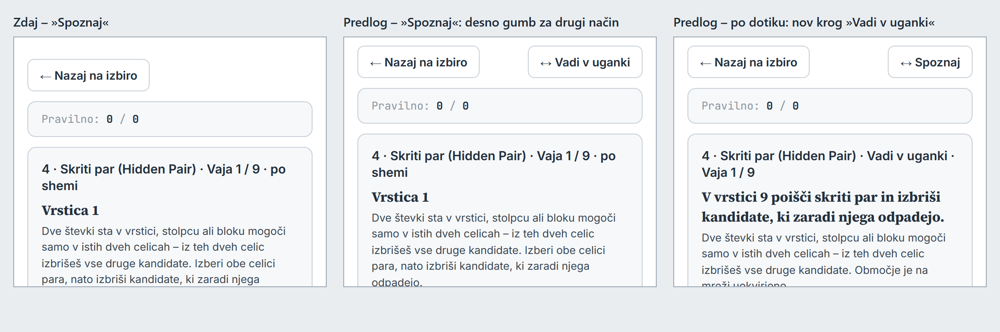
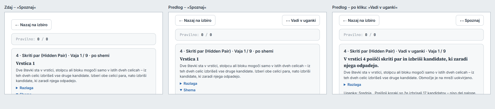
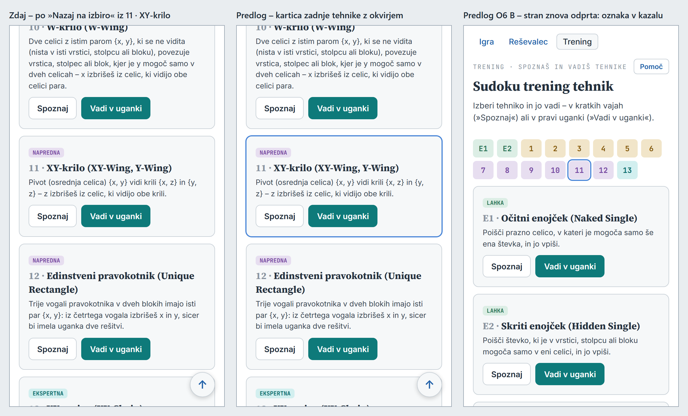
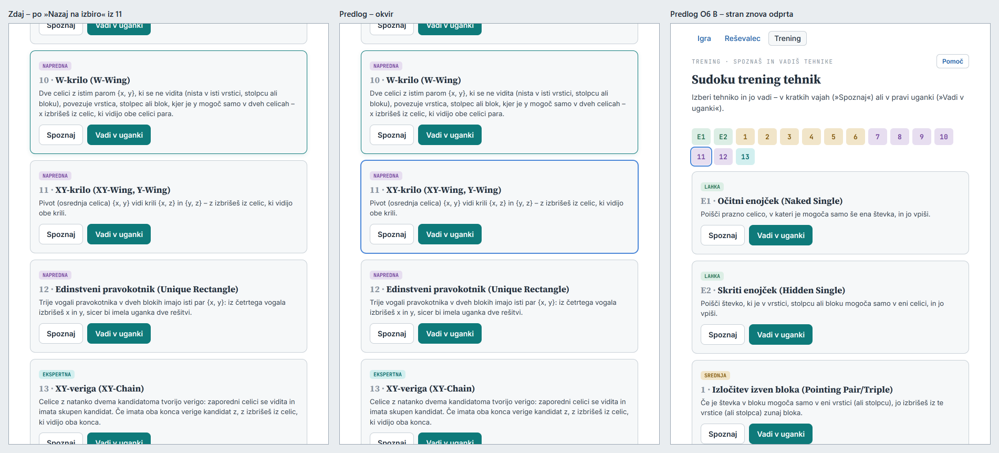
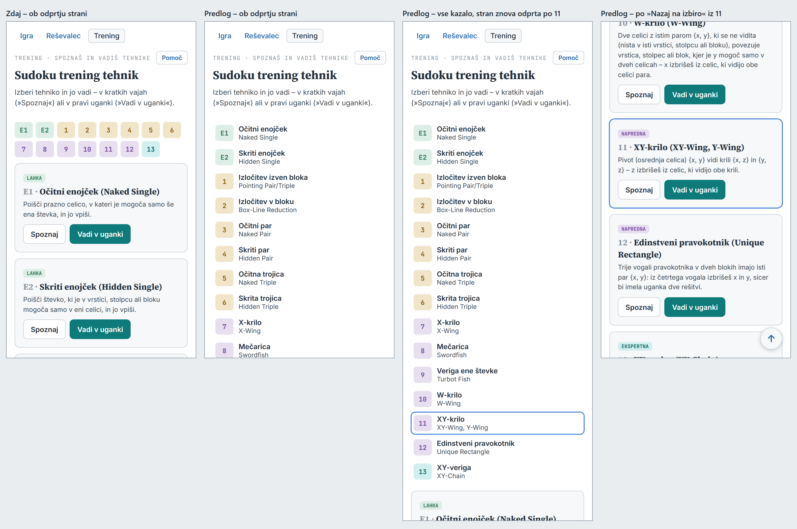
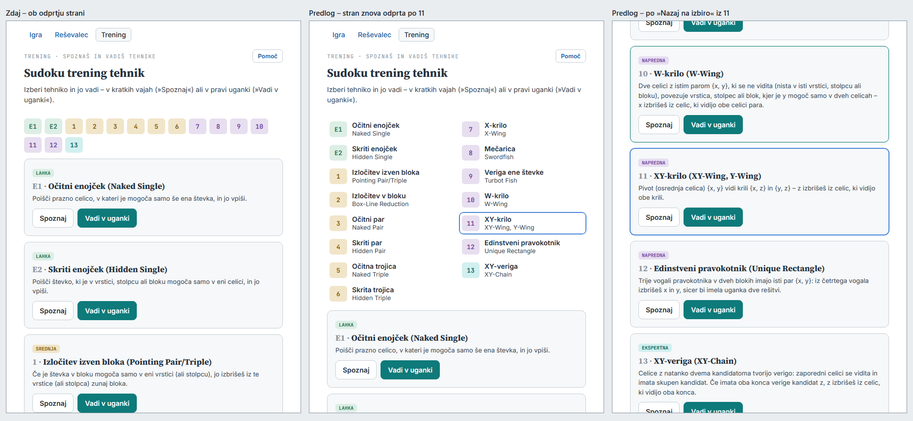
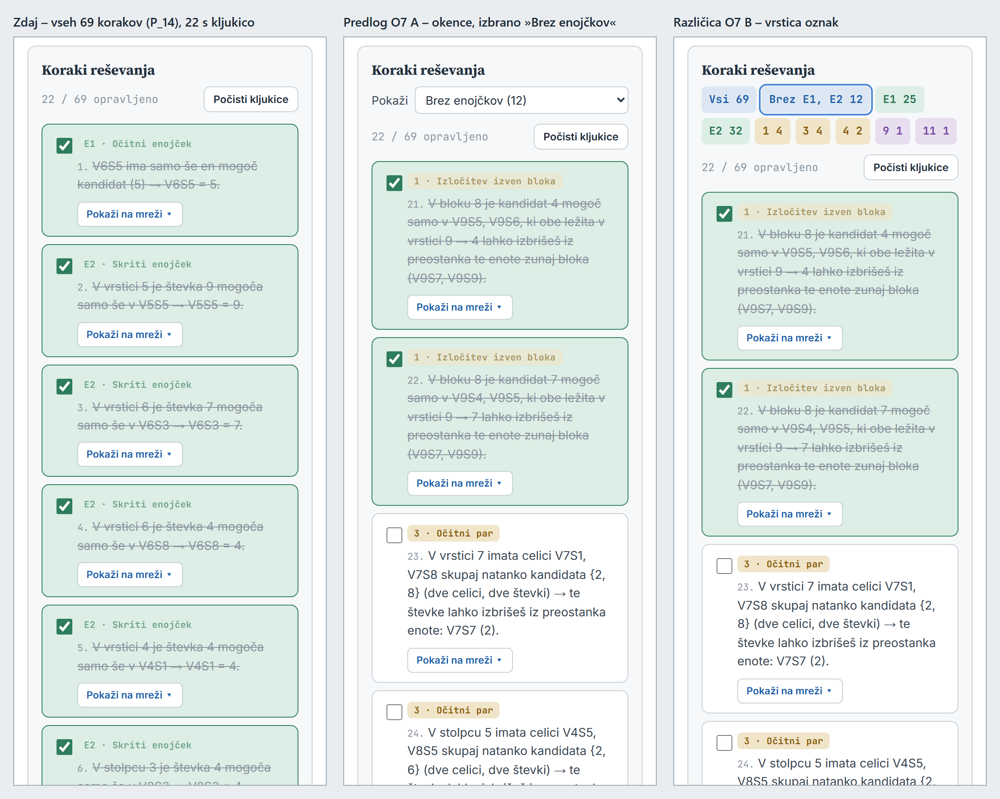
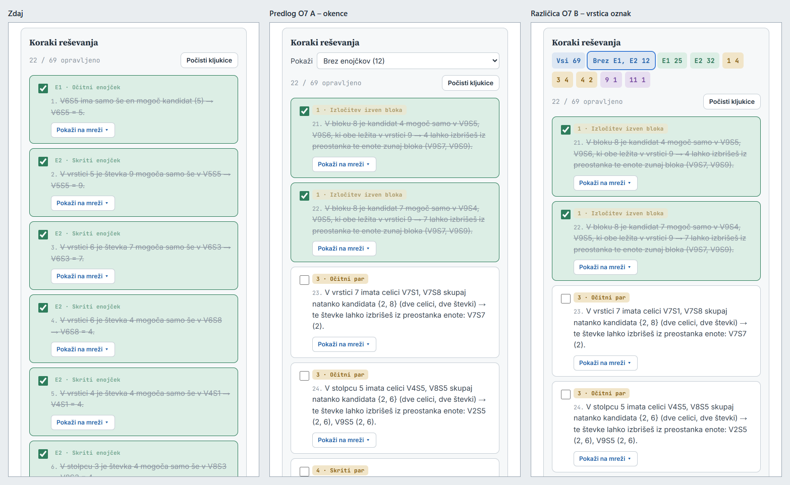
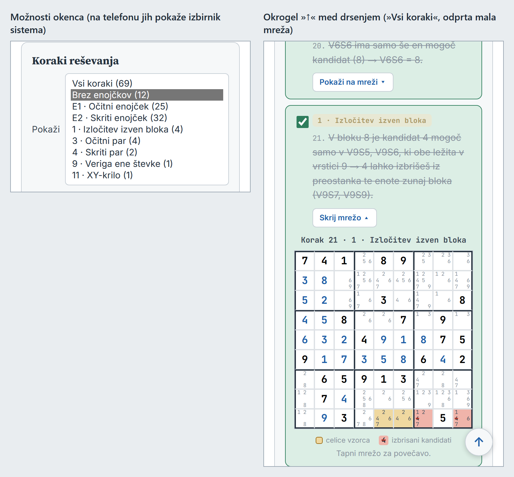
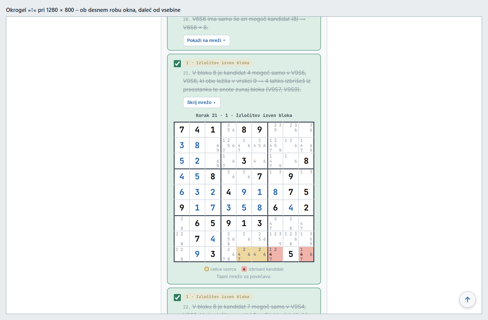

# Pripomočki za uporabo (naloga 6b) – načrt

Načrt 2026-10-11 (vir: `docs/uskladitev.md`, »Vrstni red po fazi 6«, naloga 6b). **Stanje: korak a potrjen 2026-10-11 (O1, O2, O3 = A) in narejen (korak 1); korak b dopolnjen (razdelek 2.5) – čaka potrditev; korak c še ni pregledan.**

Izhodišče: commit `b673dd3` (pravilo ob nepričakovanem izidu testa v `CLAUDE.md`).

**Cilj.** Trije pripomočki, ki skrajšajo pot do tistega, kar uporabnik išče:

- **a)** trening – iz vaje naravnost v drugi način iste tehnike (»Spoznaj« ↔ »Vadi v uganki«);
- **b)** trening – ob vrnitvi na izbiro se vidi, katero tehniko si nazadnje vadil;
- **c)** reševalec – v dolgem seznamu korakov samo koraki, ki te zanimajo (brez 50–60 enojčkov), in okrogel »↑«.

Številke so **izmerjene** v brskalniku brez glave (`tools/brskalnik.js`): 375 × 667 px s posnemanjem telefona in
1280 × 800 px. Prototip je kopija aplikacij v začasni mapi s spremembami po predlogu (ni v repozitoriju); iz njega so
meritve »predlog« in posnetki v `docs/slike/naloga6b/` (dvojna ločljivost pri 375 px, enojna pri 1280 px).

## 0. Povzetek

- **a)** V vaji desno od zgornjega »← Nazaj na izbiro« gumb **»↔ Vadi v uganki«** (v »Spoznaj«) oziroma **»↔ Spoznaj«**
  (v »Vadi v uganki«), enakega videza. Dotik začne **nov krog** iste tehnike v drugem načinu – brez vprašanja, kot
  »Nazaj na izbiro«; »Nazaj na izbiro« potem vrne na isto mesto v meniju (O1–O3).
- **b)** Kartica tehnike, ki si jo nazadnje vadil, ima **moder okvir 2 px** (barva izbire), njena vrstica v kazalu tehnik
  pa enak okvir. **Dopolnitev (2.5):** kazalo tehnik v meniju postane seznam – oznaka in ob njej slovensko in angleško
  ime v dveh vrsticah; na telefonu en stolpec, na širokem zaslonu dva. Okvir ostane, dokler ne začneš druge tehnike. Po zaprtju strani se zapomni (nov ključ
  `sudoku.trening.zadnja`) – pribl. 15 vrstic kode in en test več (O4–O6).
- **c)** Na vrhu kartice »Koraki reševanja« okence **»Pokaži«**: »Vsi koraki (69)«, »Brez enojčkov (12)«, nato vsaka
  uporabljena tehnika s številom korakov. Številke korakov ostanejo izvirne (21., 22., 27. …), kljukice in števec
  »N / M opravljeno« veljajo za vse korake. Seznam se zgradi enkrat na rešitev: »Skrij/Pokaži korake« ohrani filter,
  kljukice in odprte male mreže; »Reši« z drugimi danostmi kartico skrije (popravi obstoječo napako – razdelek 3.1).
  Okrogel **»↑«** iz naloge 4c (`ustvariNaVrh()`, brez spremembe) po enem zaslonu drsenja (O7–O11).
- **Koraki:** 1 – a, 2 – b, 3 – c in zaključek naloge (v pogovoru koraka 3). Igra se ne spremeni; reševalec in trening
  si delita samo obstoječi `shared/navigacija.js`, ki ostane enak.

## 1. Korak a – trening: prehod med načinoma

### 1.1 Kako je zdaj

- Način izbereš samo v meniju: na kartici tehnike gumba »Spoznaj« (tudi klik na kartico) in »Vadi v uganki«
  (turkizen). V vaji je nad vrstico rezultata en gumb »← Nazaj na izbiro« (`#backBtn`, 147 × 39 px), pod vajo
  vrstica »← Nazaj na izbiro« · »↑ Na vrh« (`.dno-vaje`).
- Za drugi način iste tehnike: »Nazaj na izbiro« → meni (na položaju ob odhodu) → gumb druge vrste na isti kartici.
  Krog se pri tem izgubi brez vprašanja.
- Ime načina je v vrstici nad vajo: »4 · Skriti par (Hidden Pair) · Vaja 1 / 9« oziroma »… · Vadi v uganki · Vaja 1 / 9«.

### 1.2 Predlog

- **Mesto (O1 A):** vrstica nad rezultatom postane dvodelna kot spodnja `.dno-vaje`: levo »← Nazaj na izbiro«, desno
  gumb za drugi način. Isto pravilo CSS za obe vrstici (ne kopija); `#backBtn` ohrani svoj slog.
- **Napis (O2 A):** ime ciljnega načina z dvojno puščico – »↔ Vadi v uganki« (138 × 39 px) v »Spoznaj«, »↔ Spoznaj«
  (102 px) v »Vadi v uganki«; videz kot »← Nazaj na izbiro« (razred `back-btn`), da ne tekmuje z gumbi vaje.
  Izmerjeno: pri 375 px sta gumba v eni vrstici z razmikom 58 px, pri 320 px z 8 px (brez preliva). Znak »⇄«, ki sem
  ga najprej preizkusil, ni v pisavi Inter – brskalnik ga vzame iz druge pisave in gumb je 1 px višji od sosednjega;
  »↔« je v pisavi.
- **Krog (O3 A):** dotik pokliče `zacniKrog(mode, drugi način)` – isto kot gumb na kartici: rezultat 0 / 0, vaja 1,
  nastavitve kroga (kljukice »več celic«, »senči«, »pokaži prečrtane«, razdelka Razlaga in Shema) kot ob začetku iz
  menija, iskanje »Iščem vajo …« se prekine (`vadiPrekini()` v `renderExercise()`). Položaj menija (`menuPolozaj`)
  ostane od odhoda iz menija, zato »Nazaj na izbiro« po prehodu vrne na isto kartico. Brez vprašanja – enako kot
  »Nazaj na izbiro« (O7 A v nalogi 4c); vprašanje ob zavihkih (`vprasanjeOdhoda()`) ostane in po prehodu pove novi način.
- Gumb je tudi pri »Končano!« – po krogu »Spoznaj« je »Vadi v uganki« naravni naslednji korak.
- Pri E1 in E2 gumb deluje enako (načina se skoraj ne razlikujeta – postavka v »Samo če bo potreba« ostane).
- **Pomoč treninga** (razdelek »Spoznaj in Vadi v uganki«), dopolnjen stavek: »Krog ima devet vaj. Zgoraj je rezultat,
  na koncu kroga povzetek; z **Nazaj na izbiro** izbereš drugo tehniko, z **↔ Vadi v uganki** oziroma **↔ Spoznaj**
  desno ob njem pa začneš nov krog iste tehnike v drugem načinu.«

### 1.3 Odločitve

| | Možnosti | Priporočilo |
|---|---|---|
| **O1** mesto | **A** desno v vrstici zgornjega »Nazaj na izbiro«; **B** še v spodnji vrstici `.dno-vaje` (trije gumbi: 147 + 138 + »↑ Na vrh« pri 375 px ne gredo v eno vrstico); **C** kot povezava v vrstici z imenom tehnike | A |
| **O2** napis in videz | **A** »↔ Vadi v uganki« / »↔ Spoznaj«, videz kot »Nazaj na izbiro«; **B** »Vadi v uganki →« / »Spoznaj →« (138 px); **C** »Preklopi na Vadi v uganki« (193 px – pri 375 px 147 + 8 + 193 = 348 > 343 px, ne gre v vrstico); **D** kot A, a »Vadi v uganki« turkizen kot na kartici | A |
| **O3** krog ob prehodu | **A** nov krog brez vprašanja; **B** vprašanje (`confirm`) po prvem »Preveri« v krogu, kot pri zavihkih | A |

### 1.4 Sliki

- `docs/slike/naloga6b/1-prehod-375.png` – zdaj »Spoznaj« · predlog »Spoznaj« · predlog po dotiku (»Vadi v uganki«,
  vaja 1 / 9, rezultat 0 / 0, gumb »↔ Spoznaj«).
- `docs/slike/naloga6b/1-prehod-1280.png` – isto pri 1280 px.

## 2. Korak b – trening: okvir kartice zadnje tehnike

### 2.1 Kako je zdaj

- »Nazaj na izbiro« obnovi položaj menija ob odhodu (`menuPolozaj`) in kartico po potrebi pomakne v okno – izmerjeno
  po krogu 11 · XY-krilo: kartica pri 375 px na 193–370 px okna, pri 1280 px na 260–437 px. Kartica nima nobene oznake;
  vse imajo obrobo `--line` 1 px (kontrast 1,48 : 1 na kartici).
- Pri 1280 px ima kartica pod miško turkizno obrobo in senco (`.menu-card:hover`) – na sliki 2-okvir-1280 jo ima
  kartica 10, ker je bila miška tam ob kliku »Nazaj na izbiro«.
- Ob odprtju strani je meni na vrhu; v oknu so pri 375 × 667 in pri 1280 × 800 samo kazalo tehnik in kartice E1, E2, 1.
- Trening shranjuje samo stikala seznamov (`sudoku.trening.seznami`) – opis v `docs/uskladitev.md` je popravljen
  2026-10-11 (D2). Zadnje tehnike ne shrani nič.

### 2.2 Predlog

- **Videz (O4 A):** kartica zadnje tehnike dobi razred `zadnja` – obroba in senca 1 px v barvi izbire `--izbira`
  (#4A86D8; skupaj 2 px, brez premika vsebine – višine kartic izmerjene enake), kontrast 3,46 : 1 na kartici
  (meja za grafične elemente 3 : 1). Modra je barva izbire v vseh treh aplikacijah, turkizna pa poudarek pod miško –
  na sliki pri 1280 px se oba vidita hkrati in se ločita. Vrstica te tehnike v kazalu tehnik dobi enak okvir (dopolnitev 2.5 –
  prej: modra obroba 2 px na oznaki, funkcija brez spremembe); ime v `aria-label` dobi pripis »– nazadnje vadena«.
- **Kdaj izgine (O5 A):** ne izgine sam – ostane, dokler ne začneš kroga druge tehnike; takrat se premakne nanjo.
  Okvir se postavi ob začetku kroga (`zacniKrog()`), torej tudi, če se vrneš iz »Končano!«, z zavihkom ali z gumbom
  brskalnika »Nazaj«.
- **Po zaprtju strani (O6 B):** `zacniKrog()` zapiše način vaje (npr. `xy-wing`) pod nov ključ
  `sudoku.trening.zadnja`, nalaganje strani ga prebere in označi kartico in oznako v kazalu (neznan ključ ali
  nedosegljiva shramba – nič, brez napake). Ker je ob odprtju strani meni na vrhu, kartica 11 pa daleč spodaj, je
  oznaka v kazalu edino, kar se vidi brez drsenja (slika, tretja plošča) – s seznamom iz 2.5 pri telefonu samo za
  E1–8 (O13). **Koliko dela:** pribl. 15 vrstic v
  `trening/trening.js` (branje v `try/catch`, pisanje v `zacniKrog()`), test z nadomestnim `localStorage`
  (`tests/dom-stub.js` ga ima, tudi ohranitev med »ponovnimi nalaganji«), v scenariju ponovno odprtje strani, ključ v
  seznamu ključev v `CLAUDE.md` in v opisu – korak b se podaljša za pribl. tretjino.
- **Pomoč treninga**, nov stavek za prejšnjim: »Kartica tehnike, ki si jo nazadnje vadil, ima moder okvir, njena oznaka
  v kazalu pa modro obrobo – tudi ko stran znova odpreš.« (pri O6 A brez konca stavka).
- Nadomesti postavko »nazadnje vadil« iz »Samo če bo potreba« (`docs/uskladitev.md` – že zapisano).

### 2.3 Odločitve

| | Možnosti | Priporočilo |
|---|---|---|
| **O4** videz | **A** moder okvir 2 px (`--izbira`) in obroba oznake v kazalu; **B** turkizen okvir (kot poudarek pod miško – na monitorju zamenljiv); **C** okvir in napis »nazadnje« na kartici | A |
| **O5** kdaj izgine | **A** ostane, dokler ne začneš druge tehnike; **B** izgine ob prvem dotiku ali drsenju v meniju | A |
| **O6** po zaprtju strani | **A** ne – samo do osvežitve ali zaprtja strani; **B** da – ključ `sudoku.trening.zadnja` (pribl. 15 vrstic, en test) | B |

### 2.4 Sliki

- `docs/slike/naloga6b/2-okvir-375.png` – zdaj po »Nazaj na izbiro« iz 11 · predlog z okvirjem · predlog O6 B po
  ponovnem odprtju strani (oznaka 11 v kazalu obrobljena; kartica 11 je zunaj okna). Okrogel »↑« spodaj desno je iz
  naloge 4c.
- `docs/slike/naloga6b/2-okvir-1280.png` – isto pri 1280 px (turkizna kartica 10 – poudarek pod miško).

Sliki 2-okvir-* kažeta kazalo pred dopolnitvijo (vrstica oznak); kazalo po dopolnitvi je na slikah 2b-kazalo-* (2.5).

### 2.5 Dopolnitev 2026-10-11 – kazalo tehnik v meniju kot seznam z imeni

**Zahteva** (Darko, 2026-10-11): kazalo tehnik v meniju treninga kot seznam – oznaka, ob njej v dveh vrsticah
slovensko in angleško ime; na telefonu en stolpec, na širokem zaslonu več stolpcev, brez rezanja imen; zadnja tehnika
označena v seznamu in na kartici; imena iz obstoječega vira, ista funkcija z dodatno možnostjo, ne nova kopija; kazalo
v oknu Pomoč ostane, kot je.

**Kako je zdaj** (izmerjeno): kazalo je vrstica 15 oznak 36 × 32 px (`izrisiKazaloTehnik()` iz `shared/navigacija.js`,
`.kazalo-tehnik` v `shared/base.css`), ime tehnike je samo v `title` in `aria-label` (namig miške, bralnik zaslona).
Kazalo je visoko 70 px (pri 375 px 8 + 7 oznak, pri 1280 px 12 + 3), vrh na 199 px, prva kartica na 281 px; stran menija
je visoka 3.586 px pri 375 px in 3.221 px pri 1280 px.

**Predlog** (prototip – kopija aplikacij v začasni mapi, meritve v brskalniku brez glave kot zgoraj):

- **Postavka** je gumb čez vso širino stolpca (`.kazalo-vrstica`, 44 px visok): levo oznaka v barvi ravni (isti razred
  `.tag.t-*` in iste mere 36 × 32 px kot zdaj), desno dve vrstici – slovensko ime (14 px, polkrepko, `--ink`) in
  angleško ime (12,5 px, `--ink2`, kontrast 9,35 : 1 na beli). Klik kot zdaj: pomakne do kartice (12 px pod vrh okna),
  vaje ne začne, fokus na »Spoznaj«. Pod miško siva obroba `--line` in podlaga kartice. Imeni sta vidni, zato `title`
  odpade; `aria-label` ostane »E1 · Očitni enojček (Naked Single)« iz `imeTehnike()`.
- **Stolpci:** CSS `columns: 230px` – stolpcev je, kolikor jih gre v širino menija, brez meje po napravi: pri 320–460 px
  en stolpec, pri 1280 px (meni 528 px) dva. **Vrstni red (O12 A)** po stolpcih: levo E1–6 (lahka in srednja raven,
  8 vrstic), desno 7–13 (napredna in ekspertna, 7 vrstic) – ravni ostanejo skupaj.
- **Brez rezanja:** najširše ime je 154 px (»Izločitev izven bloka«), stolpec 343 px pri 375 px, 288 px pri 320 px in
  258 px pri 1280 px. Izmerjeno: nobeno ime ni odrezano (`scrollWidth`) ne prelomljeno v dve vrstici, brez preliva.
- **Zadnja tehnika** (O4 A, O5 A, O6 B iz 2.2): vrstica v kazalu in kartica dobita razred `zadnja` – obroba in senca
  1 px `--izbira` (skupaj 2 px, brez premika vsebine; kontrast 3,69 : 1 na beli, 3,46 : 1 na kartici). Isto pravilo
  CSS za kartico in vrstico (`trening/trening.css`).
- **Okno Pomoč** kliče `izrisiKazaloTehnik()` brez nove možnosti – vrstica oznak ostane enaka v vseh treh aplikacijah.

**Izmerjeno** (px; »zdaj« – trenutna koda, »predlog« – prototip):

| | 375 × 667 zdaj | 375 × 667 predlog | 1280 × 800 zdaj | 1280 × 800 predlog |
|---|---|---|---|---|
| višina kazala | 70 | **720** | 70 | **380** |
| vrh prve kartice | 281 | 931 | 281 | 591 |
| višina strani menija | 3.586 | 4.236 | 3.221 | 3.531 |
| razporeditev | 8 + 7 oznak | 1 stolpec, 15 vrstic | 12 + 3 oznake | 2 stolpca (8 + 7) |
| vrstica 11 ob ponovnem odprtju strani | – | 775–819 (pod oknom) | – | 391–435 (v oknu) |
| kartica 11 po »Nazaj na izbiro« (okno) | 193–370 | 193–370 | 260–437 | 260–437 |

**Posledica pri telefonu:** kazalo je višje od zaslona (720 > 667 px). Ob odprtju strani se vidijo glava in vrstice
E1–8; prva kartica je 650 px nižje kot zdaj (en poteg prsta več do kartic). Vrnitev iz vaje se ne spremeni (položaj
menija se obnovi, kartica je na istem mestu). Vrstica zadnje tehnike je ob ponovnem odprtju strani vidna brez drsenja
samo pri E1–8 – pri 9–13 je pod oknom (izmerjeno za 11: 775–819 px pri oknu 667 px). Na monitorju je kazalo 380 px in
vse v oknu.

**Odločitve:**

| | Možnosti | Priporočilo |
|---|---|---|
| **O12** vrstni red pri dveh stolpcih | **A** po stolpcih – levo E1–6, desno 7–13 (ravni skupaj); **B** po vrsticah – E1 E2 / 1 2 / 3 4 … (raven se lomi čez oba stolpca) | A |
| **O13** zadnja tehnika ob ponovnem odprtju pri telefonu | **A** nič dodatnega – pri 9–13 je vrstica en poteg niže; **B** ob odprtju strani z zapomnjeno tehniko se stran pomakne, da je njena vrstica v oknu (glava gre iz okna); **C** kazalo na telefonu zložljivo (»Kazalo tehnik ▸«, zaprto 44 px – imena so na dotik dlje) | A |

**Kaj se spremeni v skupni kodi:**

- `shared/navigacija.js` (pribl. 15 vrstic):
  - `kazaloTehnik()` – postavka dobi še `slovensko` = `imeTehnike(tehnika, { anglesko: false })` in `anglesko` =
    `TEHNIKE_OPISI[kljuc].anglesko` (obstoječa vira, brez kopije imen); obstoječa polja ostanejo.
  - `izrisiKazaloTehnik(el, obKliku, { imena = false } = {})` – brez možnosti natanko kot zdaj (gumb `.tag` z oznako,
    `title`, `aria-label`, `data-kazalo`); z `{ imena: true }` gumb `.kazalo-vrstica` z oznako `.tag` in imenoma
    (`.kazalo-imena` → `.si`, `.en`), `el` dobi razred `z-imeni`. Klik, `aria-label` in `data-kazalo` sta pri obeh enaka.
- `shared/base.css` (pribl. 15 vrstic): nova pravila `.kazalo-tehnik.z-imeni` (stolpci), `.kazalo-vrstica`,
  `.kazalo-imena`; obstoječi pravili `.kazalo-tehnik` in `.kazalo-tehnik button.tag` ostaneta (okno Pomoč).
- **Uporabniki:** meni treninga kliče `izrisiKazaloTehnik(kazaloEl, …, { imena: true })`; `shared/pomoc.js` (okno Pomoč
  vseh treh) se ne spremeni – kliče brez možnosti in bere iz `kazaloTehnik()` samo `ime` in `kljuc`. Igra in
  reševalec: nič (samo okno Pomoč, enako).
- **Ni v skupni kodi:** razred `zadnja`, njegov slog in ključ `sudoku.trening.zadnja` (`trening/trening.js`,
  `trening/trening.css`).

**Slike** (prototip; 375 px v dvojni ločljivosti):

- `docs/slike/naloga6b/2b-kazalo-375.png` – zdaj ob odprtju strani · predlog ob odprtju strani · predlog: vse kazalo
  po ponovnem odprtju strani (vrstica 11 obrobljena) · predlog po »Nazaj na izbiro« iz 11 (kartica z okvirjem).
- `docs/slike/naloga6b/2b-kazalo-1280.png` – zdaj ob odprtju strani · predlog po ponovnem odprtju strani (dva stolpca,
  vrstica 11 obrobljena) · predlog po »Nazaj na izbiro« iz 11 (turkizna kartica 10 – poudarek pod miško ob kliku).

## 3. Korak c – reševalec: filter korakov in »↑«

### 3.1 Kako je zdaj

- Pod rešeno mrežo je povzetek tehnik (`#summary`, »4 · Skriti par (Hidden Pair) – 2׫, po `redTehnike()`), nato gumb
  »Pokaži korake reševanja«. Kartica »Koraki reševanja« ima naslov, vrstico »N / M opravljeno« · »Počisti kljukice« in
  seznam vseh korakov (kljukica, oznaka tehnike, »21.« in besedilo, »Pokaži na mreži ▾« z malo mrežo).
- **Dolžina:** vseh 16 vgrajenih primerov ima 58–73 korakov, od tega 54–59 enojčkov (E1, E2); korakov drugih tehnik je
  0 (P_1, Lahka) do 15 (P_16), uporabljenih tehnik največ 9 (P_16). Primer P_14 (Zelo težka): 69 korakov, 12 ne-
  enojčkov; kartica »Koraki« je pri 375 px visoka 10.979 px, vsa stran 12.737 px = 19,1 zaslona (pri 1280 px 15,5).
  Koraka 21 (prvi, ki ni enojček) brez drsenja čez 20 enojčkov ni.
- **»Skrij korake« → »Pokaži korake«** zgradi seznam znova: izmerjeno 5 kljukic in odprta mala mreža → 0 kljukic,
  mreže zaprte, »0 / 69 opravljeno«.
- **»Reši« pri odprti kartici:** kartica ostane in seznama ne zgradi znova. Pri istih danostih je to prav. **Napaka:**
  če med tem spremeniš celico v vnosni mreži (izmerjeno: vpis števke rešitve v V1S4) in pritisneš »Reši«, kartica
  ostane odprta s **starim seznamom** 69 korakov, nova rešitev pa ima 56 korakov; števec kaže »1 / 69 opravljeno«.
  (Nova uganka iz seznama primerov, zbirke ali polja Niz in »Počisti« kartico skrijejo – `skrijKorake()`.)
- Okroglega »↑« reševalec nima; `shared/navigacija.js` naloži že zdaj (kazalo tehnik v oknu Pomoč).

### 3.2 Predlog

- **Okence (O7 A):** pod naslovom kartice vrstica »Pokaži [okence]« – `<label>` z `<select>` čez vso širino kartice
  (257 × 33 px pri 375 px, 362 × 33 px pri 1280 px), pod njo vrstica števca kot zdaj.
- **Možnosti (O8 A)** – za P_14: »Vsi koraki (69)«, »Brez enojčkov (12)«, »E1 · Očitni enojček (25)«, »E2 · Skriti
  enojček (32)«, »1 · Izločitev izven bloka (4)«, »3 · Očitni par (4)«, »4 · Skriti par (2)«, »9 · Veriga ene števke
  (1)«, »11 · XY-krilo (1)«. Tehnike v vrstnem redu povzetka, ime iz `imeTehnike(…, { stevilka: true, anglesko: false })`
  (kot oznaka koraka), štetje iz iste funkcije kot povzetek pod rešitvijo (izločim jo iz obdelave »Reši« – ena
  funkcija za oba, povzetek ostane enak). »Brez enojčkov« = vse razen tehnik iz `TRENING_ENOJCKA`; možnost brez
  korakov se ne pokaže (pri lahki uganki ni »Brez enojčkov«). Poskus in protislovje je svoja možnost
  (»Poskus in protislovje (1)« pri P_16).
- **Prikaz:** koraki zunaj filtra dobijo atribut `hidden` (ostanejo v seznamu), zato:
  - številke ostanejo izvirne – pri »Brez enojčkov« P_14 se vidijo 21., 22., 23., 24., 25., 27., 28., 33., 34., 37., 38.,
    44.; tudi naslov male mreže in povečave (»Korak 21 · …«);
  - števec »N / M opravljeno« šteje vse korake (izmerjeno »22 / 69 opravljeno« pri prikazanih 12), »Počisti kljukice«
    pobriše tudi skrite;
  - **odprte male mreže (O9 A)** ostanejo, kot so – skrit korak z odprto mrežo je ob »Vsi koraki« spet odprt.
- **Seznam enkrat na rešitev (O10 A):** seznam in okence se zgradita ob prvem »Pokaži korake reševanja« po »Reši«;
  »Skrij« / »Pokaži« ju samo skrije in pokaže (filter, kljukice in male mreže ostanejo). »Reši« z **drugimi**
  danostmi kartico skrije kot nova uganka (`skrijKorake()`) – ob naslednjem »Pokaži« je seznam nove rešitve,
  filter »Vsi koraki«, brez kljukic; »Reši« z istimi danostmi ne spremeni ničesar. To popravi napako s starim
  seznamom (3.1) in spremeni obstoječe obnašanje »Skrij → Pokaži« (kljukice se ne izgubijo več) – zato je
  odločitev tvoja.
- **Okrogel »↑« (O11 A):** `ustvariNaVrh(() => true)` iz `shared/navigacija.js` – ista funkcija in isti slog
  (`button.na-vrh`, 44 × 44 px, 16 px od roba) kot v meniju treninga, brez spremembe. Viden po enem zaslonu drsenja
  kjerkoli na strani, klik pomakne na vrh strani (fokus se ne premakne – fokus na prvi celici bi na telefonu odprl
  tipkovnico). Povečava (z-index 2000) in okni (1500) sta nad njim (20). Izmerjeno pri 375 px: med drsenjem gumb
  (315–359 × 607–651 px okna) kdaj prekrije spodnji desni kot odprte male mreže ali legende pod njo – dotik tam
  pomakne na vrh namesto povečave; pri 1280 px je gumb ob robu okna, 340 px od vsebine.
- **Pomoč reševalca** (razdelek »Rešitev in koraki«), nov odstavek: »Z okencem **Pokaži** na vrhu korakov izbereš,
  katere korake vidiš: vse, brez enojčkov ali samo korake ene tehnike. Številke korakov ostanejo, kljukice in števec
  veljajo za vse korake. Gumb ↑ spodaj desno te vrne na vrh strani.«

### 3.3 Odločitve

| | Možnosti | Priporočilo |
|---|---|---|
| **O7** oblika | **A** okence `<select>` »Pokaži« (na telefonu izbirnik sistema); **B** vrstica oznak v barvah ravni kot kazalo tehnik (»Vsi 69«, »Brez E1, E2 12«, »E1 25« …; pri P_14 dve vrstici, 70 px) – zahteva razširitev `izrisiKazaloTehnik()` z neobveznim seznamom postavk, ki jo uporabljata meni treninga in okno Pomoč vseh treh aplikacij | A |
| **O8** napisi | **A** »Vsi koraki (69)«, »Brez enojčkov (12)«, »4 · Skriti par (2)«, brez možnosti z 0 koraki; **B** kot povzetek »4 · Skriti par (Hidden Pair) – 2׫ (pri 375 px se dolgi napisi v zaprtem okencu odrežejo); **C** kot A, a »Brez enojčkov (0)« onemogočeno namesto skrito | A |
| **O9** odprte male mreže ob menjavi filtra | **A** ostanejo, kot so; **B** vse se zaprejo | A |
| **O10** seznam ob »Skrij/Pokaži« in novem »Reši« | **A** seznam enkrat na rešitev (Skrij/Pokaži ohrani vse), »Reši« z drugimi danostmi kartico skrije; **B** kot zdaj (vsak »Pokaži« zgradi znova – filter »Vsi koraki«, kljukice se izgubijo), »Reši« kartico vedno skrije; **C** kot zdaj brez popravka (okence bi po spremenjeni uganki kazalo stare možnosti) – ni priporočljivo | A |
| **O11** okrogel »↑« | **A** vedno po enem zaslonu, na vrh strani (`ustvariNaVrh()` brez spremembe); **B** samo pri odprti kartici korakov; **C** na vrh kartice »Koraki« (k okencu) – nov neobvezen parameter cilja v `ustvariNaVrh()` | A |

### 3.4 Slike

- `docs/slike/naloga6b/3-filter-375.png` – P_14, 22 kljukic: zdaj (vsi koraki) · predlog O7 A z izbrano »Brez
  enojčkov (12)« (koraki 21., 22., 23. …, števec »22 / 69«) · različica O7 B (vrstica oznak).
- `docs/slike/naloga6b/3-filter-1280.png` – isto pri 1280 px.
- `docs/slike/naloga6b/4-moznosti-na-vrh-375.png` – možnosti okenca (za sliko prikazane kot seznam; na telefonu jih
  pokaže izbirnik sistema) · okrogel »↑« med drsenjem pri odprti mali mreži.
- `docs/slike/naloga6b/4-na-vrh-1280.png` – »↑« pri 1280 × 800 ob desnem robu okna.

## 4. Kaj se uporabi znova (brez nove kopije)

- **Okrogel »↑«:** `ustvariNaVrh()` in `naVrhViden()` iz `shared/navigacija.js`, slog `button.na-vrh` iz
  `shared/base.css` – v reševalcu en klic, funkcija in slog ostaneta enaka (pri O11 C bi dobila neobvezen parameter).
- **Kazalo tehnik:** pri b) `izrisiKazaloTehnik()` dobi neobvezno možnost `{ imena: true }` (2.5), `kazaloTehnik()` polji
  `slovensko` in `anglesko` iz `imeTehnike()` in `TEHNIKE_OPISI`; vrstica v meniju dobi razred `zadnja`. Pri O7 B bi
  funkcija dobila še neobvezen seznam postavk (ne kopija).
- **Vrstica gumbov:** zgornja vrstica vaje uporabi isto pravilo CSS kot spodnja `.dno-vaje`; gumb ima razred `back-btn`.
- **Imena, vrstni red, štetje:** `imeTehnike()`, `redTehnike()`, `TRENING_ENOJCKA` (katere tehnike so enojčki) in ena
  funkcija štetja za povzetek in okence.
- **Začetek kroga:** prehod kliče obstoječo `zacniKrog()`; okvir in zapis zadnje tehnike gresta vanjo.

## 5. Vpliv na drugi dve aplikaciji

- **Igra:** nič. Posnetek igre (`tools/posnetek-igre.js --primerjaj tools/posnetki/igra-po-xy-veriga.json`) mora biti
  brez razlik.
- **Skupna koda:** pri b) se `shared/navigacija.js` in `shared/base.css` spremenita (možnost `{ imena: true }`, nova
  pravila – 2.5); okno Pomoč vseh treh ostane enako (kliče brez možnosti) – potrdi scenarij
  `tools/preveri-navigacija-brskalnik.js` (korak 3) in primerjava izračunanih slogov okna Pomoč z izhodiščem. Pri O7 B ali O11 C se `shared/navigacija.js` spremeni (neobvezen
  parameter); takrat scenarij `tools/preveri-navigacija-brskalnik.js` potrdi, da sta meni in Pomoč enaka.
- **Trening ↔ reševalec:** nič skupnega razen zgornjega. Nov ključ `sudoku.trening.zadnja` (O6 B) bere in piše samo
  trening; igra in reševalec ga ne poznata.
- **Okno Pomoč:** spremeni se samo besedilo v `trening/index.html` (a, b) in `app/index.html` (c); `shared/pomoc.js`
  ostane.

## 6. Kaj se ne spremeni

- Vaje, preverjanje, štetje rezultata, kartice menija in klik nanje, zgornji in spodnji »Nazaj na izbiro« in njun
  učinek, kazalo tehnik in »↑« v meniju.
- Reševanje (`solve()`), povzetek pod rešitvijo, korak in njegova mala mreža, povečava in Escape, kljukice in
  »Počisti kljukice« (razen obnašanja ob »Skrij/Pokaži« pri O10 A), zbirka in samodejno shranjevanje.
- Obstoječi ključi shrambe; brez novih knjižnic.

## 7. Koraki

Vsak korak v svojem pogovoru: najprej test, ki na stari kodi pade, nato sprememba; sprotno hitri testi, pred commitom
vsi; nov scenarij `tools/preveri-naloga6b-brskalnik.js` (raste po korakih – `--korak N`, pri 375 px pravi dotik, pri
1280 px miška); commit in push. Logika brez DOM-a (napis gumba, možnosti okenca, ali je korak viden) v funkcijah, ker
nadomestni DOM nima `querySelector`; razporeditev preveri brskalnik.

1. **a) Prehod med načinoma** (O1–O3). Test v `tests/trening-meni.test.js`: gumb je v vaji obeh načinov in pri
   »Končano!«, napis po načinu, klik → drugi način, vaja 1, rezultat 0 / 0, meni skrit, `menuPolozaj` enak (»Nazaj na
   izbiro« vrne na isto mesto), prekinjeno iskanje »Iščem vajo …«; stavek v Pomoči (testi besedil). Brskalnik: 320,
   375, 1280 px – gumba v eni vrstici, enako visoka, brez preliva; vseh 15 tehnik v obeh smereh s pravim dotikom/klikom;
   `preveri-navigacija-brskalnik.js` (zgornji in spodnji »Nazaj«) in posnetek igre brez razlik.
2. **b) Okvir kartice in kazalo s seznamom** (O4–O6, O12, O13). Test: kazalo z imeni – 15 vrstic v vrstnem redu
   kartic, oznaka in razred ravni, slovensko ime = `imeTehnike(…, { anglesko: false })`, angleško = `TEHNIKE_OPISI[].anglesko`,
   `aria-label`, klik vaje ne začne; brez možnosti enako kot prej (okno Pomoč); obstoječi test kazala v
   `tests/trening-meni.test.js` (napis gumba = oznaka, `title`) se za meni treninga namerno spremeni. Po vrnitvi natanko
   ena kartica in ena vrstica kazala z `zadnja`, nova tehnika ga premakne; O6 B – zapis ob začetku kroga, branje ob nalaganju (shramba nadomestnega DOM-a med dvema nalaganjema),
   neznan ključ in shramba, ki vrže napako. Brskalnik: 320, 375, 1280 px – stolpci (1, 1, 2), vrstni red po
   stolpcih, nobeno ime odrezano ali prelomljeno, brez preliva, pravi dotik/klik vsake vrstice → kartica; okno Pomoč enako
   izhodišču; izračunana barva in širina okvirja, kontrast vsaj 3 : 1, višine kartic enake, okvir se loči od poudarka pod
   miško, ponovno odprta stran (O6 B), brez preliva; `CLAUDE.md` – ključ.
3. **c) Filter in »↑«** (O7–O11) **in zaključek naloge.** Test (nov `tests/resevalec-koraki.test.js`): možnosti iz
   dnevnika P_14, P_1 (brez »Brez enojčkov«) in P_16 (poskus), število in vrstni red, štetje enako povzetku; filter
   skrije korake z izvirnimi številkami, števec in »Počisti kljukice« za vse; O9, O10 (Skrij/Pokaži, »Reši« z istimi
   in z drugimi danostmi); »↑« ustvarjen. Brskalnik: 320, 375, 1280 px – okence v kartici, brez preliva, prava izbira
   s tipkovnico (fokus, puščica), vidne številke, »↑« skrit na vrhu in viden po enem zaslonu, pravi dotik/klik → vrh,
   povečava nad »↑«, Escape jo zapre. **Zaključek** (isti pogovor): vsi testi, scenarij vseh treh korakov,
   `preveri-navigacija-`, `preveri-videz-brskalnik.js`, posnetek igre; `CLAUDE.md` (scenarij, ključ), opisi
   (`docs/opis/trening.md`, `resevalec.md`, `orodja.md`, `testi.md`, `dokumenti.md`), `docs/rocni-test.md` (razdelek
   »Naloga 6b«), `docs/uskladitev.md` (naloga 6b); ročni pregled.

## 8. Ročni pregled (enkrat, po koraku 3)

1. **Trening, telefon:** v vaji dotik »↔ Vadi v uganki«, nato »↔ Spoznaj«, nato »Nazaj na izbiro«. Pričakovano: nov
   krog v drugem načinu, meni na kartici tehnike. *Zakaj ročno:* presoja, ali je gumb ob »Nazaj na izbiro« prepoznaven
   in ga pravi prst ne zadene pomotoma.
2. **Trening, telefon in monitor:** vrnitev iz vaje; nato zapri zavihek in trening odpri znova. Pričakovano: kartica
   zadnje tehnike z modrim okvirjem, na monitorju jasno drugačna od poudarka pod miško; po ponovnem odprtju obrobljena
   vrstica v kazalu; kazalo na telefonu v enem stolpcu, na monitorju v dveh, imena berljiva in cela. *Zakaj ročno:* presoja vidnosti barve; pravo zapiranje brskalnika na telefonu.
3. **Reševalec, telefon:** primer P_14, »Reši«, »Pokaži korake reševanja«, v okencu »Brez enojčkov«. Pričakovano:
   izbirnik sistema z vsemi možnostmi, nato samo koraki 21., 22., … *Zakaj ročno:* izbirnika sistema brskalnik brez
   glave ne pokaže.
4. **Reševalec, telefon:** pri »Vsi koraki« odpri nekaj malih mrež in drsi; dotik »↑«. Pričakovano: gumb ne moti
   dotika male mreže, vrne na vrh. *Zakaj ročno:* presoja s pravim prstom in inercijskim drsenjem.

## 9. Odločitve (čaka potrditev)

Priporočilo: **O1 A, O2 A, O3 A, O4 A, O5 A, O6 B, O7 A, O8 A, O9 A, O10 A, O11 A**; dopolnitev b: **O12 A, O13 A**.
Potrjeno 2026-10-11: O1, O2, O3 = A.

Ročni pregled je en sam, po koraku 3, največ 5 točk; po korakih 1 in 2 ga ni.

## 10. Izvedba

**Potrditev 2026-10-11:** korak a – O1, O2, O3 = A. Korak b se dopolni (razdelek 2.5), korak c še ni pregledan. Ob
potrditvi zapisano še: D1 – `docs/rocni-test.md`, naloga 6a, točka 2 potrjena (pred načrtom 6b sta bila prebrana
opisa treninga in reševalca); D2 – `docs/uskladitev.md`: trening shranjuje `sudoku.trening.seznami`; D3 –
`docs/uskladitev.md`, naloga 11 in razdelek 1.3: angleško ime tehnike je vedno prikazano ob imenu v izbranem jeziku,
izjema je izbrana angleščina.

**Korak 1 – prehod med načinoma (a), narejen 2026-10-11.** `trening/index.html` – zgornja vrstica `.vrh-vaje` z
`#backBtn` in `#drugiNacin`, stavek v Pomoči; `trening/trening.css` – eno pravilo `.vrh-vaje,.dno-vaje`;
`trening/trening.js` – `drugiNacin()`, `napisDrugegaNacina()`, napis v `zacniKrog()`, klik → `zacniKrog(mode,
drugiNacin(nacin))`. Testi v `tests/trening-meni.test.js` (trije novi, na stari kodi padejo vsi trije), scenarij
`tools/preveri-naloga6b-brskalnik.js --korak 1`.

- Izmerjeno (scenarij): pri 375 px »Nazaj« 16–163 px, »↔ Vadi v uganki« 221–359 × 39 px, razmik 58 px; »↔ Spoznaj«
  257–359 px, razmik 94 px; pri 1280 px razmik 243 oziroma 279 px – kot v napovedi.
- **Odstopanje od napovedi pri 320 px:** napoved »v eni vrstici z razmikom 8 px, brez preliva« drži, a gumba (147 +
  8 + 138 = 293 px > 288 px prostora) se v »Spoznaj« skrčita in napisa se prelomita v dve vrstici – oba gumba 56 px
  visoka (»Nazaj« 144 px, »↔ Vadi v uganki« 136 px široka); v »Vadi v uganki« sta v eni vrstici (39 px). Prototip
  tega ni izpisal. Videz ni spremenjen brez tvoje odločitve – možnosti so v povzetku koraka.
- `tools/preveri-navigacija-brskalnik.js` (vsi koraki): 1517 preverjanj drži, 22 ne. **16** – popravek B pri 320 px
  (»Spoznaj« 15 tehnik in »Končano!«): spodnja gumba nista »istega videza kot zgornji«, ker je zgornji »Nazaj na izbiro«
  zaradi preloma 56 px visok (spodnja 39 px) – ista posledica kot zgoraj; pri 375 in 1280 px vse drži. **6** – D1 (okni
  »Zbirka ugank« in »Nova uganka« v igri, zbirka v reševalcu) proti izhodišču `5f59f09`: razlike v slogih glave okna
  izvirajo iz poznejših commitov naloge 4c in 6, ne iz tega koraka – korak ne spremeni nobene datoteke igre, reševalca
  ali `shared/`; z `--samo 3 --izhodisce HEAD` vseh šest drži. Scenarija nisem spreminjal.
- Posnetek igre: enako, 99 posnetkov. Scenarij `tools/preveri-naloga6b-brskalnik.js --korak 1`: vse drži (pribl. 2 min).

